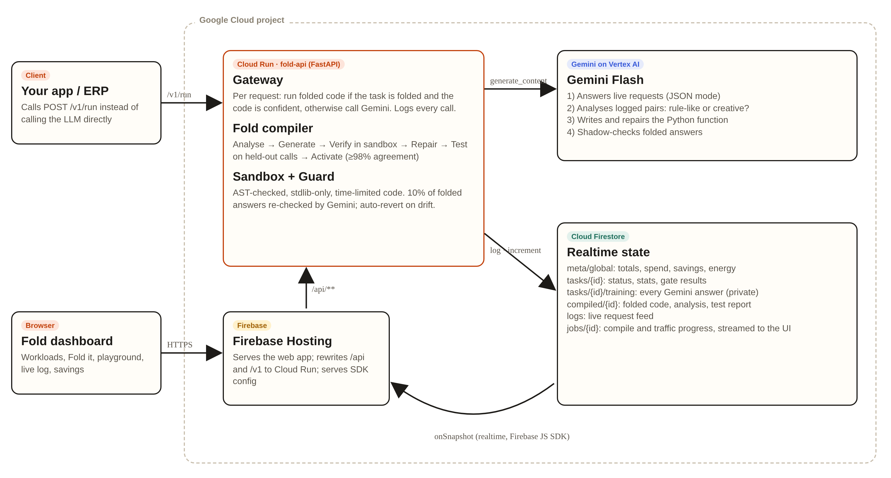

# Fold: fold repeated AI calls into free, verified code

**Team Origamind** (Neeti Singh, Pratyush Singh) · AI Builder Cup 2026

Most production LLM traffic is the same job repeated thousands of times: pull the date and total from an invoice, map a purchase request to a material category, route a ticket. Companies pay for every one of those calls, even though after a few hundred examples the job is just rules.

**Fold** sits between your app and Gemini. It watches the traffic, asks Gemini whether each workload is rule-like or truly creative, has Gemini **write a small Python function** that reproduces its own answers, **proves** that function on calls it never saw, and then serves those requests as **free, instant code**. Anything unusual, and anything creative, still goes to Gemini. A share of folded answers is continuously re-checked by Gemini, and Fold reverts automatically if quality drifts.

> Other AI-cost tools make each LLM call cheaper (routing, caching, compression). Fold removes the call.



## How the Google Cloud stack is used

| Technology | What it does in Fold |
|---|---|
| **Gemini (Vertex AI)** | 1) Answers live requests in JSON mode. 2) Analyses logged input/output pairs and decides whether a task is compilable. 3) Writes the Python function and repairs it from its own mismatches. 4) Shadow-checks a sample of folded answers in production. |
| **Cloud Run** | `fold-api` (FastAPI): the drop-in `/v1/run` gateway, the compiler pipeline, the sandbox and the drift guard. It scales to zero, keeps CPU always allocated for background compile jobs, and calls Vertex AI with its service account, so no API key is stored anywhere. |
| **Cloud Firestore** | System of record: every Gemini answer (the training set), live request log, per-task stats and spend, compiled functions with their test reports, and job progress. |
| **Firebase** | **Hosting** serves the dashboard and rewrites `/api/**` and `/v1/**` to Cloud Run. The **Firebase JS SDK** streams Firestore in realtime (`onSnapshot`), so KPIs, the request log and the step-by-step compile timeline update live. **Security rules** expose only aggregates and keep raw training data private. |

## The compiler pipeline

1. **Collect**: at least 30 logged Gemini answers for the task; 60% to learn from, 40% held out.
2. **Analyse**: Gemini looks for a deterministic pattern. Free text (replies, summaries) is declared *not compilable* and stays on Gemini.
3. **Generate**: Gemini writes `run(text) -> dict | None`. Returning `None` means "not sure", which sends that request to Gemini.
4. **Verify and repair**: the function runs in a sandbox (AST allow-list, stdlib only: `re`, `datetime`, `json`, `math`, `decimal`; no I/O, no dunder access, 0.5 s time limit). Mismatches go back to Gemini for up to 2 repair rounds.
5. **Test**: precision and coverage on the held-out calls. It goes live only if **precision ≥ 98%** and **coverage ≥ 50%**.
6. **Guard**: 10% of folded answers are re-checked by Gemini. If agreement falls below 95% after 20 checks, the task reverts to Gemini automatically.

## Demo workloads

| Workload | Why it's there | Expected outcome |
|---|---|---|
| Invoice field extraction (IN, DE, GB, SG, AU, US invoices; 4 layouts, 7 date formats, Indian lakh and EU decimal-comma numbers) | Classic AP automation | Folds into code |
| Material master normalisation (category + base unit of measure) | ERP master-data hygiene | Folds into code |
| Customer complaint reply | Genuinely creative | Fold refuses and keeps it on Gemini |

Traffic is synthetic but realistic, generated in `backend/tasks.py`. Every LLM answer in the demo is a real Gemini call.

## API

```bash
curl -X POST https://<project>.web.app/v1/run \
  -H "Content-Type: application/json" \
  -d '{"task":"material_normalize","input":"Hex bolt M12x50 zinc plated"}'
# {"route":"compiled","output":{"category":"FASTENER","base_uom":"EA"},"cost_usd":0.0,"latency_ms":1,...}
```

Other endpoints: `POST /api/tasks/{id}/simulate`, `POST /api/tasks/{id}/compile`, `POST /api/tasks/{id}/revert`, `GET /api/compiled/{id}`, `GET /api/state`.

## Run it yourself

**Deploy (Google Cloud Shell):**
```bash
bash deploy.sh YOUR_PROJECT_ID
```
This enables the APIs, creates Firestore, deploys Cloud Run, adds Firebase, deploys Hosting and rules, and sets a budget alert. The app is then live at `https://YOUR_PROJECT_ID.web.app`.

**Local, offline (no Gemini, for UI and sandbox tests):**
```bash
cd backend && pip install -r requirements.txt
MOCK_GEMINI=1 STORE=memory SERVE_FRONTEND=1 uvicorn main:app --port 8080
```

## Cost guardrails

A daily cap on Gemini calls (`DAILY_LLM_CAP`, default 4,000), Cloud Run scales to zero with at most 2 instances, a billing budget alert, and per-request input size limits.

## Energy and cost figures

- Cost is computed from real token usage reported by Gemini, multiplied by the model's list price (`PRICE_IN_PER_M` / `PRICE_OUT_PER_M`).
- Energy avoided uses Google's published median for a Gemini Apps text prompt (0.24 Wh, 0.03 gCO₂e, August 2025) per call served as code.

## Limits and next steps

- The sandbox runs in-process with thread time limits; production would use a separate gVisor or Cloud Run job per function.
- Next: auto-discover task boundaries from raw prompts, an SDK wrapper for OpenAI-style clients, per-tenant isolation, and folding into small fine-tuned models where rules aren't enough.

## Repo layout

```
backend/   FastAPI service for Cloud Run (gateway, compiler, sandbox, store, demo tasks)
frontend/  Firebase Hosting dashboard (vanilla JS + Firebase SDK)
docs/      architecture diagram
deploy.sh  one-shot Google Cloud deploy · push_github.sh  publish repo
```

MIT License
